# Gemini Enterprise for Customer Experience (GECX) $\rightarrow$ ADK Agent Runtime Blueprint

A minimal, end-to-end reference repository showing how **Gemini Enterprise for Customer Experience (GECX / `ces.googleapis.com`)** routes customers across **distinct GECX sub-agent flows** on the Agent Studio canvas and invokes an external **Google ADK Agent** on **Vertex AI Agent Runtime (`reasoningEngines`)** across project/organization boundaries with **maximum least-privilege security**:
1. **Flow 1 — Shopping & Catalog Journey (`lumiere_shopping_agent`)**: Native GECX shopping specialist with catalog search, SKU pricing/ingredient lookup, cart management, and checkout (`shop_lumiere_catalog`).
2. **Flow 2 — Visual Skin Diagnosis & Separate GECX Product Recommendation Sub-Agent (`skin_diagnosis_agent` $\rightarrow$ `lumiere_product_recommendation_agent`)**:
   - **Stage 1 (`skin_diagnosis_agent` — No Image Uploaded)**: Enforces a deterministic **Conditional Image Gate (`skin_image_uploaded`)** and calls `request_skin_image_upload` to ask the customer for a photo of their skin condition.
   - **Stage 1 (`skin_diagnosis_agent` — Image Uploaded $\rightarrow$ ADK Clinical Diagnosis)**: Delegates visual skin diagnosis via **A2A (`RemoteAgentTool`)** using a dedicated custom caller Service Account (`serviceAccountAuthConfig`) and a single-permission custom IAM role (`aiplatform.reasoningEngines.query`) bound exclusively at the `ReasoningEngine` resource level to a **Google ADK Agent** on **Vertex AI Agent Runtime** (`gemini-3.8-flash`). The ADK Agent identifies what is wrong with the skin (`analysis_id`, `apparent_skin_type`, `hydration_level`, `visible_markers`, `primary_concern_tags`, `key_recommended_actives`, `visual_summary`) **without recommending any actual products or SKUs**, and `skin_diagnosis_agent` immediately transfers control to `lumiere_product_recommendation_agent`.
   - **Stage 2 (`lumiere_product_recommendation_agent` — Separate GECX Product Recommendation Sub-Agent)**: Dedicated GECX sub-agent that receives the ADK clinical diagnosis and calls `recommend_lumiere_products` to match the clinical findings against the official GECX Lumiere product catalog (`CLN-CICA-01`, `TRM-AZEL-05`, `SPF-MIN-04`, etc.) and recommend a personalized AM/PM routine.

---

## 1. Architecture & 2-Project Cross-Boundary Topology

```mermaid
flowchart LR
    User(["Customer (Chat / Image)"]) --> Root

    subgraph ProjA ["Project A: GECX Front-End Project (ces.googleapis.com)"]
        Root["GECX Root Router\n(lumiere_concierge_root_agent)"]
        
        subgraph Flow1 ["Flow 1: Shopping Journey"]
            ShopAgent["Shopping Sub-Agent\n(lumiere_shopping_agent)"]
            ShopTool["shop_lumiere_catalog\n(Browse / Cart / Checkout)"]
            ShopAgent --> ShopTool
        end

        subgraph Flow2 ["Flow 2: Skin Diagnosis & Separate Product Recommendation Sub-Agent"]
            SkinDiagAgent["Skin Diagnosis Sub-Agent\n(skin_diagnosis_agent)"]
            Gate["Conditional Gate\n(beforeModelCallbacks +\nbeforeToolCallbacks)"]
            UploadTool["1. request_skin_image_upload"]
            A2ATool["2. RemoteAgentTool (A2A v1.0)\n(skincare_adk_agent_runtime_tool)"]
            CallerSA["Custom Caller SA\n(gecx-skincare-caller@ProjA)"]
            ProdRecAgent["Product Recommendation Sub-Agent\n(lumiere_product_recommendation_agent)"]
            RecTool["3. recommend_lumiere_products\n(GECX Product Recommender)"]

            SkinDiagAgent --> Gate
            Gate -- "skin_image_uploaded == False" --> UploadTool
            Gate -- "1. skin_image_uploaded == True" --> A2ATool
            A2ATool --> CallerSA
            SkinDiagAgent -- "2. Handoff after ADK Diagnosis" --> ProdRecAgent
            ProdRecAgent -- "adk_diagnosis_completed == True" --> RecTool
        end

        Root -- "Shopping / Cart Intent" --> ShopAgent
        Root -- "Skin Photo / Diagnosis Intent" --> SkinDiagAgent
        ShopAgent -- "Switch to Skin Diagnosis" --> SkinDiagAgent
    end

    subgraph ProjB ["Project B: Agent Host Project (Vertex AI Agent Runtime)"]
        subgraph Tier2 ["Tier 2: Vertex AI Agent Runtime (reasoningEngines)"]
            REIAM["Resource-Level IAM\n(roles/singleAgentInvoker:\naiplatform.reasoningEngines.query ONLY)"]
            ADKServer["FastAPI A2A Server\n(/api/a2a/v1/message:send)"]
            ADKAgent["Google ADK Agent\n(gemini-3.8-flash)"]
            VisionTool["analyze_skin_condition_image\n(Gemini 3.8 Flash Structured Output)"]
            SessionTrace["VertexAiSessionService +\nOpenTelemetry Traces / Logs / Metrics"]

            CallerSA -- "OAuth2 Token +\ngecx_a2a_agent_context" --> REIAM
            REIAM --> ADKServer
            ADKServer --> ADKAgent
            ADKAgent --> VisionTool
            ADKAgent --> SessionTrace
        end
    end
```



| Project / Tier | Component | Runtime | Responsibility |
| :--- | :--- | :--- | :--- |
| **Project A — Tier 1 (Root)** | **Lumiere Concierge Router** (`lumiere_concierge_root_agent`) | **GECX** (`ces.googleapis.com`) | Answers store policy FAQs directly and routes the customer to either `lumiere_shopping_agent` (Flow 1) or `skin_diagnosis_agent` (Flow 2) based on their user journey. |
| **Project A — Tier 1 (Flow 1)** | **Shopping & Catalog Sub-Agent** (`lumiere_shopping_agent`) | **GECX** (`ces.googleapis.com`) | Handles catalog browsing, active ingredient & price lookups, shopping cart additions, and express checkout via `shop_lumiere_catalog`. |
| **Project A — Tier 1 (Flow 2, Stage 1)** | **Skin Diagnosis Sub-Agent** (`skin_diagnosis_agent`) | **GECX** (`ces.googleapis.com`) | Enforces a **Conditional Image Gate**: (1) calls `request_skin_image_upload` if no photo is present; (2) once an image is uploaded, delegates visual diagnosis to Project B's ADK Agent (`skincare_adk_agent_runtime_tool`); (3) immediately hands off to `lumiere_product_recommendation_agent`. |
| **Project A — Tier 1 (Flow 2, Stage 2)** | **Product Recommendation Sub-Agent** (`lumiere_product_recommendation_agent`) | **GECX** (`ces.googleapis.com`) | Dedicated GECX sub-agent that takes the clinical skin diagnosis from `skin_diagnosis_agent` and calls `recommend_lumiere_products` to recommend matching Lumiere catalog SKUs and an AM/PM routine. |
| **Project B — Tier 2** | **Clinical Diagnosis ADK Agent** ([`skincare_adk_agent/`](skincare_adk_agent/)) | **Vertex AI Agent Runtime** (`reasoningEngines`) | Built with `google-adk` (`gemini-3.8-flash`). Extracts the uploaded image from GECX's A2A metadata (`gecx_a2a_agent_context`), records **Sessions**, **Traces**, **Logs**, and **Metrics** in Vertex AI Agent Engine (`GOOGLE_CLOUD_AGENT_ENGINE_ENABLE_TELEMETRY=true`), analyzes the image with `gemini-3.8-flash` Structured Outputs (`VisualAssessment`), and identifies what is wrong with the skin **without recommending any commercial product SKUs**. |

---

## 2. Quickstart: One-Command Deployment (Single-Project or 2-Project Cross-Boundary)

> **Instructions for AI Coding Agents (`Claude Code`, `Gemini CLI`, `Cursor`, `Jetski`)**:
> 1. Ensure the user is authenticated (`gcloud auth login` / `gcloud auth application-default login`) and has provided target **GCP Project ID(s)** with billing enabled.
> 2. Run `python3 deploy_all.py --project-id <AGENT_HOST_PROJECT_ID> --gecx-project-id <GECX_FRONTEND_PROJECT_ID> --region europe-west1 --ces-location us` (omit `--gecx-project-id` if deploying into a single project).
> 3. `deploy_all.py` requires **no local Docker daemon** (it builds and pushes the OCI image directly to Artifact Registry via HTTP V2 API), automatically configures the 3-part least-privilege cross-project IAM policy, enables Agent Engine telemetry (`GOOGLE_CLOUD_AGENT_ENGINE_ENABLE_TELEMETRY=true`), and executes the 4-turn live multi-flow E2E verification suite (`scripts/test_e2e.py`).

### Prerequisites

```bash
pip install -r skincare_adk_agent/requirements.txt pillow
gcloud auth login
gcloud auth application-default login
```

### Option A: 2-Project Cross-Boundary Deployment (Recommended for Enterprise Demos)

```bash
python3 deploy_all.py \
  --project-id YOUR_AGENT_HOST_PROJECT_ID \
  --gecx-project-id YOUR_GECX_FRONTEND_PROJECT_ID \
  --region europe-west1 \
  --ces-location us
```

### Option B: Single-Project Deployment

```bash
python3 deploy_all.py \
  --project-id YOUR_GCP_PROJECT_ID \
  --region europe-west1 \
  --ces-location us
```

### Optional Teardown

```bash
python3 deploy_all.py \
  --project-id YOUR_AGENT_HOST_PROJECT_ID \
  --gecx-project-id YOUR_GECX_FRONTEND_PROJECT_ID \
  --teardown
```

---

## 3. How the Core Integration Patterns Work

1. **Multi-Flow Journey Routing & Sub-Agent Handoff in GECX ([`scripts/setup_gecx.py`](scripts/setup_gecx.py))**:
   - **`lumiere_concierge_root_agent`**: Connects to two user-journey branches on the GECX Studio canvas (`childAgents: [lumiere_shopping_agent, skin_diagnosis_agent]`).
   - **Flow 1 (`lumiere_shopping_agent`)**: Executes catalog browsing, ingredient/price lookups, cart additions, and checkout via `shop_lumiere_catalog`.
   - **Flow 2, Stage 1 (`skin_diagnosis_agent`)**: Owns skin condition intake, enforces the conditional image upload gate (`request_skin_image_upload`), invokes the external ADK Agent (`skincare_adk_agent_runtime_tool`) to identify what is wrong with the skin, and immediately transfers control (`childAgents: [lumiere_product_recommendation_agent]`) to the dedicated Product Recommendation Sub-Agent.
   - **Flow 2, Stage 2 (`lumiere_product_recommendation_agent`)**: Separate GECX sub-agent that receives the ADK clinical diagnosis and calls `recommend_lumiere_products` to match clinical concern tags to Lumiere catalog SKUs.
2. **Conditional Delegation Gate in GECX ([`scripts/setup_gecx.py`](scripts/setup_gecx.py))**:
   - **`beforeModelCallbacks`**: Inspects `llm_request.contents` before the model runs; as soon as an uploaded image (`inline_data`) is present in the session, it sets `callback_context.variables["skin_image_uploaded"] = True`.
   - **`beforeToolCallbacks`**: Deterministically blocks `skincare_adk_agent_runtime_tool` if `skin_image_uploaded` is `False`, and blocks `recommend_lumiere_products` until `adk_diagnosis_completed` is `True`.
3. **Multimodal Image Forwarding Over A2A ([`skincare_adk_agent/server.py`](skincare_adk_agent/server.py))**:
   - When GECX invokes `RemoteAgentTool`, it attaches the multimodal conversation history inside `message.metadata["gecx_a2a_agent_context"]`. `extract_a2a_input()` extracts the base64 image from `history[].chunks[].image` and passes it to `analyze_skin_condition_image`.
4. **Agent Engine Sessions, Traces, Logs & Dashboards ([`skincare_adk_agent/server.py`](skincare_adk_agent/server.py))**:
   - Sets `GOOGLE_CLOUD_AGENT_ENGINE_ENABLE_TELEMETRY=true` in `ReasoningEngine.spec.deploymentSpec.env` and initializes `VertexAiSessionService` plus `google.adk.telemetry.google_cloud.get_gcp_exporters(enable_cloud_tracing=True, enable_cloud_metrics=True, enable_cloud_logging=True)`. Every delegated conversation populates the **Google Cloud Console $\rightarrow$ Vertex AI $\rightarrow$ Agent Engine $\rightarrow$ Dashboards, Sessions & Traces** tabs.

---

## 4. Cross-Organization / Cross-Project Least-Privilege Authentication (Org A $\rightarrow$ Org B)

To guarantee that **Org A / Project A (GECX)** can invoke **only that single ADK agent in Org B / Project B**—and has zero access to any other agents, Vertex AI models, Memory Banks, or project resources in Org B—`deploy_all.py` automatically provisions three controls:

1. **A dedicated Custom Service Account (`serviceAccountAuthConfig`) in Project A** (instead of using the shared GECX Service Agent directly).
2. **A single-permission Custom IAM Role (`aiplatform.reasoningEngines.query` only) in Project B** (never use `roles/aiplatform.user`, which grants ~440 permissions including `.delete` on other agents and model inference across the project).
3. **Resource-level IAM (`:setIamPolicy`) on the specific `ReasoningEngine` resource** (zero project-wide IAM bindings in Project B).

---

## 5. Repository Layout

```text
gemini-cx-adk-integration/
├── .env.example                    # Customer configuration template (1-project or 2-project)
├── .gitignore
├── README.md                       # Architecture & setup guide (this file)
├── deploy_all.py                   # One-command End-to-End GCP Provisioner & Verifier
├── scripts/
│   ├── oci_builder.py              # Auth helper + daemonless OCI image builder for Artifact Registry
│   ├── setup_gecx.py               # Provisions Tier 1 Multi-Flow GECX App (4 agents) + serviceAccountAuthConfig
│   └── test_e2e.py                 # Live 4-turn E2E test across GECX Project -> ADK Host Project
└── skincare_adk_agent/             # Tier 2: Google ADK Agent on Vertex AI Agent Runtime
    ├── Dockerfile
    ├── README.md
    ├── agent.py                    # ADK root_agent (gemini-3.8-flash) + direct visual diagnosis FunctionTool
    ├── requirements.txt
    └── server.py                   # FastAPI A2A v1.0 server + VertexAiSessionService + OpenTelemetry
```
