# Gemini Enterprise for Customer Experience (GECX) $\rightarrow$ Google ADK Agent Runtime $\rightarrow$ Cloud Run API Blueprint

A production-grade, end-to-end reference architecture demonstrating how to integrate **Gemini Enterprise for Customer Experience (GECX / Customer Engagement Suite — `ces.googleapis.com`)** with a **Google Agent Development Kit (ADK)** specialist agent deployed on **Vertex AI Agent Runtime (`reasoningEngines`)**, which in turn invokes a serverless **Cloud Run API** powered by **Nano Banana 2 (`gemini-3.1-flash-image`)**.

---

## 1. End-to-End Architecture Overview

```mermaid
flowchart LR
    User(["Customer (Image + Query)"]) --> GECX

    subgraph Tier1 ["Tier 1: Gemini Enterprise for Customer Experience (ces.googleapis.com)"]
        GECX["GECX Root Agent\n(lumiere_concierge_root_agent)"]
        Gate1["beforeModelCallbacks\n(Detects inline_data image ->\nskin_image_uploaded = True)"]
        Gate2["beforeToolCallbacks\n(Hard Condition Gate:\nBlocks ADK call if image=False\nor consent=False)"]
        UploadTool["PythonFunction Tool\n(request_skin_image_upload)"]
        A2ATool["RemoteAgentTool (A2A v1.0)\n(skincare_adk_agent_runtime_tool)"]

        GECX --> Gate1
        Gate1 --> Gate2
        Gate2 -- "No Image Uploaded" --> UploadTool
        Gate2 -- "Image Uploaded & Consent=True" --> A2ATool
    end

    subgraph Tier2 ["Tier 2: Vertex AI Agent Runtime (reasoningEngines)"]
        ADKServer["FastAPI A2A v1.0 Server\n(/api/a2a/v1/message:send)"]
        ADKAgent["Google ADK Agent\n(gemini-3.8-flash)"]
        SessionSvc["VertexAiSessionService\n(Managed Agent Engine Sessions)"]
        OTel["OpenTelemetry Exporter\n(Agent Engine Traces)"]
        CRTool["ADK FunctionTool\n(analyze_skincare_image_on_cloud_run)"]

        A2ATool -- "A2A v1.0 HTTP+JSON\n(Extracts image from\ngecx_a2a_agent_context)" --> ADKServer
        ADKServer --> ADKAgent
        ADKAgent --> SessionSvc
        ADKAgent --> OTel
        ADKAgent --> CRTool
    end

    subgraph Tier3 ["Tier 3: Cloud Run Microservice"]
        CRAPI["Cloud Run FastAPI Service\n(skincare-nano-banana-api\nPOST /v1/analyze-skin)"]
        NanoBanana["Vertex AI Nano Banana 2\n(gemini-3.1-flash-image)"]

        CRTool -- "OIDC ID Token Auth\n+ Base64 Image JSON" --> CRAPI
        CRAPI --> NanoBanana
    end
```



### How the 3 Tiers Work Together

| Tier | Component | Platform & Runtime | Role in the Blueprint |
| :--- | :--- | :--- | :--- |
| **Tier 1** | **Lumiere Clinical Skincare Concierge** | **Gemini Enterprise for Customer Experience** (`ces.googleapis.com`) | Primary customer-facing concierge agent. Handles store policy FAQs directly and enforces a **Two-Layer Conditional Delegation Gate** so delegation to the ADK agent only happens when the customer has uploaded a skincare image (`skin_image_uploaded == True`) and granted consent (`diagnostic_consent_granted == True`). |
| **Tier 2** | **Lumiere Skincare Specialist ADK Agent** | **Vertex AI Agent Runtime** (`aiplatform.googleapis.com` `reasoningEngines`) | Built with `google-adk` (`gemini-3.8-flash`). Receives A2A v1.0 requests from GECX at `/api/a2a/v1/message:send`, extracts the customer's uploaded image from `message.metadata.gecx_a2a_agent_context`, persists session events via `VertexAiSessionService`, exports spans to Vertex AI Agent Engine **Traces**, and calls the Tier 3 Cloud Run API as an ADK `FunctionTool`. |
| **Tier 3** | **Skincare Nano Banana Analysis API** | **Google Cloud Run** (`run.googleapis.com`) | Serverless FastAPI microservice (`POST /v1/analyze-skin`) invoked by the ADK agent with an OIDC ID token. Calls **Nano Banana 2 (`gemini-3.1-flash-image`)** on Vertex AI to perform visual cosmetic dermatology analysis and match concerns against the Lumiere product catalog. |

---

## 2. Quickstart: Automated End-to-End Provisioning (For Humans & AI Agents)

> **Instructions for AI Coding Agents (`Claude Code`, `Gemini CLI`, `Cursor`, `Jetski`)**:
> To deploy this entire 3-tier blueprint into a customer's Google Cloud project from scratch, follow these exact steps:
> 1. Ensure the user is authenticated with Google Cloud (`gcloud auth login` and/or `gcloud auth application-default login`) and has provided their target **GCP Project ID** (with billing enabled).
> 2. Copy `.env.example` to `.env` and set `GCP_PROJECT_ID=<CUSTOMER_PROJECT_ID>` (or pass `--project-id <CUSTOMER_PROJECT_ID>` directly on the CLI).
> 3. Run `python3 deploy_all.py --project-id <CUSTOMER_PROJECT_ID> --region europe-west1 --ces-location us`.
> 4. `deploy_all.py` requires **zero local Docker daemon** (it builds and pushes deterministic OCI images directly to Artifact Registry via HTTP V2 API) and automatically runs a 4-turn live end-to-end verification suite upon completion.

### Prerequisites

1. **Google Cloud Project** with Billing enabled.
2. **Python 3.11+** with `requests`, `google-auth`, `pillow`, and `pip` installed:
   ```bash
   pip install -r skincare_api/requirements.txt
   pip install pillow
   ```
3. **Google Cloud Authentication**:
   ```bash
   gcloud auth login
   gcloud auth application-default login
   ```

### One-Command End-to-End Provisioning

1. Configure your environment variables (optional if passing CLI flags):
   ```bash
   cp .env.example .env
   # Edit .env and set GCP_PROJECT_ID=your-gcp-project-id
   ```
2. Run the end-to-end provisioning and verification script:
   ```bash
   python3 deploy_all.py \
     --project-id YOUR_GCP_PROJECT_ID \
     --region europe-west1 \
     --ces-location us
   ```
   *(Tip: Pass `--ces-location both` to provision the GECX application in both the `us` and `eu` multi-regions.)*

### What `deploy_all.py` Automates

1. **Step 1 — Enable GCP APIs**: Enables `run.googleapis.com`, `artifactregistry.googleapis.com`, `aiplatform.googleapis.com`, `ces.googleapis.com`, `cloudtrace.googleapis.com`, `telemetry.googleapis.com`, `iam.googleapis.com`, and `cloudresourcemanager.googleapis.com`.
2. **Step 2 — Provision Service Identities & IAM**: Triggers `generateServiceIdentity` for Vertex AI (`gcp-sa-aiplatform-re`), GECX (`gcp-sa-ces`), and Cloud Run, and binds least-privilege IAM roles (`roles/aiplatform.user`, `roles/run.invoker`, `roles/cloudtrace.agent`, `roles/telemetry.tracesWriter`, `roles/artifactregistry.reader`).
3. **Step 3 — Artifact Registry**: Creates the Docker repository (`gecx-skincare-repo`) in your target region.
4. **Step 4 — Daemonless OCI Container Build & Push**: Stages Python 3.11 Linux `x86_64` wheels, pulls the public `gcr.io/distroless/python3-debian12:latest` base layers, and pushes both `skincare-nano-banana-api:latest` and `skincare-adk-agent:latest` directly to Artifact Registry.
5. **Step 5 — Deploy Tier 3 Cloud Run API**: Deploys `skincare-nano-banana-api` to Cloud Run and configures `roles/run.invoker` for the Vertex AI Reasoning Engine service agent.
6. **Step 6 — Deploy Tier 2 ADK Agent on Vertex AI Agent Runtime**: Deploys `lumiere-skincare-adk-agent-runtime` (`reasoningEngines`) with `containerSpec`, automatically handling first-time Vertex AI tenant project warm-up, and patches `GOOGLE_CLOUD_AGENT_ENGINE_ID` into the runtime environment so **Sessions** (`VertexAiSessionService`) and **Traces** (`OpenTelemetry`) populate in the Google Cloud Console.
7. **Step 7 — Provision Tier 1 GECX Application**: Creates the GECX App (`Lumiere Clinical Skincare Concierge`), state variables (`skin_image_uploaded`, `diagnostic_consent_granted`, `delegation_gate_status`), callbacks (`beforeModelCallbacks`, `beforeToolCallbacks`), tools (`request_skin_image_upload`, `skincare_adk_agent_runtime_tool`), `AppVersion`, and Web `Deployment`.
8. **Step 8 — Run 4-Turn Live End-to-End Verification**: Executes `scripts/test_e2e_workflow.py` against `ces.googleapis.com` (`SessionService.RunSession`) and verifies session creation in Vertex AI Agent Engine.

---

## 3. Deep Dive: Key Architectural Patterns

### 3.1 Conditional Delegation in GECX (`beforeModelCallbacks` + `beforeToolCallbacks`)

A common enterprise requirement in **Gemini Enterprise for Customer Experience (GECX)** is ensuring that a specialist downstream agent is **only** invoked when specific preconditions are met (for example, an image has been uploaded and customer consent is active).

This blueprint enforces conditional delegation at **two independent layers** in [`scripts/setup_gecx_app.py`](scripts/setup_gecx_app.py):

1. **`beforeModelCallbacks` (Automatic Image Detection)**:
   - Before the GECX root model is called, a Python callback inspects `llm_request.contents` for any `inline_data` image bytes.
   - As soon as an uploaded image is detected in the conversation, it sets `callback_context.variables["skin_image_uploaded"] = True` and `callback_context.variables["delegation_gate_status"] = "CONDITION_MET_IMAGE_UPLOADED"`.
2. **`beforeToolCallbacks` (Deterministic Guardrail Gate)**:
   - If the LLM attempts to invoke `skincare_adk_agent_runtime_tool` while `skin_image_uploaded == False` or `diagnostic_consent_granted == False`, `beforeToolCallbacks` intercepts the tool call **before any network request leaves GECX** and returns a structured `DELEGATION_CONDITION_NOT_MET` message instructing the root agent to call `request_skin_image_upload` instead.

### 3.2 Multimodal Image Forwarding Over A2A (`gecx_a2a_agent_context`)

When GECX invokes a `RemoteAgentTool` over the A2A v1.0 protocol, the tool's input schema only sends a text `task` parameter in `message.parts`. However, GECX automatically attaches the full multimodal conversation history inside `message.metadata["gecx_a2a_agent_context"]`:

```json
{
  "message": {
    "parts": [{"text": "Analyze cheek redness and dry patches"}],
    "metadata": {
      "gecx_a2a_agent_context": "{\"history\":[{\"role\":\"USER\",\"chunks\":[{\"image\":{\"mimeType\":\"image/png\",\"data\":\"<BASE64_BYTES>\"}}]}]}"
    }
  }
}
```

In [`skincare_adk_agent/skincare_adk_agent/a2a_server.py`](skincare_adk_agent/skincare_adk_agent/a2a_server.py), `extract_a2a_input()` inspects both inline A2A parts (`raw` / `file.fileWithBytes`) and `metadata.gecx_a2a_agent_context.history[].chunks[].image`, ensuring seamless image forwarding whether the ADK agent is wired as a **Tool (`RemoteAgentTool`)** or a **Sub-agent (`RemoteA2aAgent`)**.

### 3.3 Populating Vertex AI Agent Engine **Sessions** & **Traces** with Custom Containers

When deploying an ADK agent on Vertex AI Agent Runtime (`reasoningEngines`) using a custom container (`containerSpec`), two configurations in [`a2a_server.py`](skincare_adk_agent/skincare_adk_agent/a2a_server.py) ensure full observability in the Google Cloud Console:

1. **Managed Sessions (`VertexAiSessionService`)**:
   - Replacing `InMemorySessionService()` with `VertexAiSessionService(project=PROJECT_ID, location=AGENT_ENGINE_LOCATION, agent_engine_id=AGENT_ENGINE_ID)` persists every session and event (`user` prompt $\rightarrow$ `functionCall` $\rightarrow$ `functionResponse` $\rightarrow$ `model` synthesis) directly into Vertex AI Agent Engine's **Sessions** tab.
2. **Managed Traces (`_setup_agent_engine_telemetry`)**:
   - Exporting OpenTelemetry spans to `https://telemetry.googleapis.com/v1/traces` (`OTLPSpanExporter`) and Cloud Trace (`CloudTraceSpanExporter`) with resource attributes `cloud.platform="gcp.agent_engine"`, `cloud.resource_id="//aiplatform.googleapis.com/projects/<PROJECT_ID>/locations/<REGION>/reasoningEngines/<ENGINE_ID>"`, and `gen_ai.main_agent.id="urn:agent:projects-<PROJECT_NUMBER>:projects:<PROJECT_NUMBER>:locations:<REGION>:aiplatform:reasoningEngines:<ENGINE_ID>"` populates the Agent Engine **Traces** tab.

---

## 4. Repository Structure

```text
gemini-cx-adk-integration/
├── .env.example                               # Template for customer GCP project settings
├── .gitignore                                 # Prevents committing .env, keys, or build caches
├── README.md                                  # Master architecture & setup guide (this file)
├── deploy_all.py                              # One-command End-to-End Provisioner & Verifier
├── scripts/
│   ├── README.md                              # Documentation for automation & test scripts
│   ├── gcp_auth.py                            # OAuth2 credential & project number resolver
│   ├── push_oci_image.py                      # Daemonless OCI image builder & Artifact Registry uploader
│   ├── setup_gecx_app.py                      # GECX (ces.googleapis.com) App, Agent, Callback & Tool provisioner
│   └── test_e2e_workflow.py                   # Live 4-turn E2E test suite against ces.googleapis.com
├── skincare_api/                              # Tier 3: Cloud Run Skincare Image Analysis API
│   ├── Dockerfile                             # Standard Dockerfile for Cloud Run
│   ├── README.md                              # Tier 3 API documentation
│   ├── app.py                                 # FastAPI app invoking Nano Banana (gemini-3.1-flash-image)
│   └── requirements.txt
└── skincare_adk_agent/                        # Tier 2: Google ADK Agent on Vertex AI Agent Runtime
    ├── Dockerfile                             # Standard Dockerfile for Agent Runtime custom container
    ├── README.md                              # Tier 2 ADK Agent documentation
    ├── pyproject.toml
    ├── requirements.txt
    ├── skincare_adk_agent/
    │   ├── a2a_server.py                      # Unified A2A v1.0 + ReasoningEngine HTTP server
    │   ├── agent.py                           # ADK root_agent (gemini-3.8-flash)
    │   ├── cli.py                             # Standalone CLI test runner
    │   ├── config.py                          # Environment-driven configuration
    │   ├── prompts.py                         # Clinical Skincare Specialist system instructions
    │   └── tools/
    │       └── cloud_run_skincare_tool.py     # ADK FunctionTool calling Cloud Run API with OIDC auth
    └── tests/
        └── test_a2a_agent.py                  # Unit tests for A2A v1.0 & GECX metadata extraction
```
