# Gemini Enterprise for Customer Experience (GECX) $\rightarrow$ ADK Agent Runtime $\rightarrow$ Cloud Run Blueprint

A minimal, end-to-end reference repository showing how to connect **Gemini Enterprise for Customer Experience (GECX / `ces.googleapis.com`)** to a **Google ADK Agent** deployed on **Vertex AI Agent Runtime (`reasoningEngines`)**, which invokes a **Cloud Run Vision API** powered by **Gemini 3.8 Flash (`gemini-3.8-flash`)**.

---

## 1. Architecture & Request Flow

```mermaid
flowchart LR
    User(["Customer (Image + Query)"]) --> GECX

    subgraph Tier1 ["Tier 1: GECX (ces.googleapis.com)"]
        GECX["GECX Root Agent\n(lumiere_concierge_root_agent)"]
        Gate["Conditional Image Gate\n(beforeModelCallbacks +\nbeforeToolCallbacks)"]
        UploadTool["request_skin_image_upload"]
        A2ATool["RemoteAgentTool (A2A v1.0)\n(skincare_adk_agent_runtime_tool)"]

        GECX --> Gate
        Gate -- "skin_image_uploaded == False" --> UploadTool
        Gate -- "skin_image_uploaded == True" --> A2ATool
    end

    subgraph Tier2 ["Tier 2: Vertex AI Agent Runtime (reasoningEngines)"]
        ADKServer["FastAPI A2A Server\n(/api/a2a/v1/message:send)"]
        ADKAgent["Google ADK Agent\n(gemini-3.8-flash)"]
        SessionTrace["VertexAiSessionService +\nOpenTelemetry Cloud Trace"]
        CRTool["analyze_skincare_image_on_cloud_run"]

        A2ATool -- "A2A v1.0 HTTP+JSON\n(gecx_a2a_agent_context)" --> ADKServer
        ADKServer --> ADKAgent
        ADKAgent --> SessionTrace
        ADKAgent --> CRTool
    end

    subgraph Tier3 ["Tier 3: Cloud Run Microservice"]
        CRAPI["Cloud Run FastAPI Service\n(POST /v1/analyze-skin)"]
        Gemini["Vertex AI Gemini 3.8 Flash\n(Structured JSON Output)"]

        CRTool -- "OIDC ID Token +\nBase64 Image" --> CRAPI
        CRAPI --> Gemini
    end
```



| Tier | Component | Runtime | Responsibility |
| :--- | :--- | :--- | :--- |
| **Tier 1** | **Lumiere Concierge Agent** ([`scripts/setup_gecx.py`](scripts/setup_gecx.py)) | **GECX** (`ces.googleapis.com`) | Answers store policy FAQs directly and enforces a **Conditional Delegation Gate** (`skin_image_uploaded`): blocks ADK delegation until the customer uploads a skincare image. |
| **Tier 2** | **Skincare Specialist ADK Agent** ([`skincare_adk_agent/`](skincare_adk_agent/)) | **Vertex AI Agent Runtime** (`reasoningEngines`) | Built with `google-adk` (`gemini-3.8-flash`). Extracts the uploaded image from GECX's A2A metadata (`gecx_a2a_agent_context`), records **Sessions** & **Traces** in Vertex AI Agent Engine, and invokes the Cloud Run API tool. |
| **Tier 3** | **Skincare Vision API** ([`skincare_api/`](skincare_api/)) | **Google Cloud Run** (`run.googleapis.com`) | FastAPI microservice (`POST /v1/analyze-skin`) that analyzes the image using **`gemini-3.8-flash`** with Pydantic **Structured Outputs** (`response_schema=VisualAssessment`) and matches products from the catalog. |

---

## 2. Quickstart: One-Command Deployment (For Humans & AI Agents)

> **Instructions for AI Coding Agents (`Claude Code`, `Gemini CLI`, `Cursor`, `Jetski`)**:
> 1. Ensure the user is authenticated (`gcloud auth login` / `gcloud auth application-default login`) and has provided a target **GCP Project ID** with billing enabled.
> 2. Run `python3 deploy_all.py --project-id <YOUR_GCP_PROJECT_ID> --region europe-west1 --ces-location us`.
> 3. `deploy_all.py` requires **no local Docker daemon** (it builds and pushes OCI images directly to Artifact Registry via HTTP V2 API) and automatically executes the 3-turn live E2E verification suite (`scripts/test_e2e.py`).

### Prerequisites

```bash
pip install -r skincare_api/requirements.txt pillow
gcloud auth login
gcloud auth application-default login
```

### Provision & Verify End-to-End

```bash
cp .env.example .env
# Pass your GCP Project ID via CLI flag or .env:
python3 deploy_all.py \
  --project-id YOUR_GCP_PROJECT_ID \
  --region europe-west1 \
  --ces-location us

# Optional: Tear down all blueprint resources when finished testing:
python3 deploy_all.py --project-id YOUR_GCP_PROJECT_ID --teardown
```

---

## 3. How the Core Integration Patterns Work

1. **Conditional Delegation Gate in GECX ([`scripts/setup_gecx.py`](scripts/setup_gecx.py))**:
   - **`beforeModelCallbacks`**: Inspects `llm_request.contents` before the model runs; as soon as an uploaded image (`inline_data`) is present in the session, it sets `callback_context.variables["skin_image_uploaded"] = True`.
   - **`beforeToolCallbacks`**: Deterministically blocks `skincare_adk_agent_runtime_tool` if `skin_image_uploaded` is `False`, prompting the root agent to call `request_skin_image_upload` instead.
2. **Multimodal Image Forwarding Over A2A ([`skincare_adk_agent/server.py`](skincare_adk_agent/server.py))**:
   - When GECX invokes `RemoteAgentTool`, it attaches the multimodal conversation history inside `message.metadata["gecx_a2a_agent_context"]`. `extract_a2a_input()` extracts the base64 image from `history[].chunks[].image` and passes it to the ADK `FunctionTool`.
3. **Agent Engine Sessions & Traces ([`skincare_adk_agent/server.py`](skincare_adk_agent/server.py))**:
   - Uses `VertexAiSessionService` and OpenTelemetry (`OTLPSpanExporter` + `CloudTraceSpanExporter` with `cloud.platform="gcp.agent_engine"`) so every delegated conversation appears in the **Google Cloud Console $\rightarrow$ Vertex AI $\rightarrow$ Agent Engine $\rightarrow$ Sessions & Traces** tabs.

---

## 4. Cross-Organization Least-Privilege Authentication (Org A $\rightarrow$ Org B)

To guarantee that **Org A (GECX)** can invoke **only that single ADK agent in Org B**—and has zero access to any other agents, Vertex AI models, Memory Banks, or project resources in Org B—you should combine three controls:

1. **A dedicated Custom Service Account (`serviceAccountAuthConfig`) in Org A** (instead of using the shared GECX Service Agent directly).
2. **A single-permission Custom IAM Role (`aiplatform.reasoningEngines.query` only) in Org B** (never use `roles/aiplatform.user`, which grants ~440 permissions including `.delete` on other agents and model inference across the project).
3. **Resource-level IAM (`:setIamPolicy`) on the specific `ReasoningEngine` resource** (or an IAM Condition locked to that exact resource ID), never a project-wide binding.

### Step 1: Side A (Org A — GECX Project)
Create a dedicated, single-purpose Service Account for this integration and allow only Org A's GECX Service Agent to mint short-lived tokens for it:

```bash
# 1. Create a dedicated caller SA in Org A
gcloud iam service-accounts create gecx-skincare-caller \
  --display-name="GECX Caller for Org B Skincare ADK Agent" \
  --project=<ORG_A_PROJECT_ID>

# 2. Allow Org A's CES Service Agent to impersonate ONLY this SA
gcloud iam service-accounts add-iam-policy-binding \
  gecx-skincare-caller@<ORG_A_PROJECT_ID>.iam.gserviceaccount.com \
  --member="serviceAccount:service-<ORG_A_PROJECT_NUMBER>@gcp-sa-ces.iam.gserviceaccount.com" \
  --role="roles/iam.serviceAccountTokenCreator" \
  --project=<ORG_A_PROJECT_ID>
```

Configure `apiAuthentication.serviceAccountAuthConfig` on the GECX `RemoteAgentTool` (or `RemoteA2aAgent`):

```json
{
  "remoteAgentTool": {
    "agentCard": { "...": "..." },
    "apiAuthentication": {
      "serviceAccountAuthConfig": {
        "serviceAccount": "gecx-skincare-caller@<ORG_A_PROJECT_ID>.iam.gserviceaccount.com"
      }
    }
  }
}
```

### Step 2: Side B (Org B — ADK Agent Runtime Project)
Create a custom IAM role containing **only** `aiplatform.reasoningEngines.query` and bind it directly to the single `ReasoningEngine` resource via `:setIamPolicy`:

```bash
# 1. Create a single-permission Custom IAM Role in Org B
gcloud iam roles create singleAgentInvoker \
  --project=<ORG_B_PROJECT_ID> \
  --title="Single Reasoning Engine Invoker" \
  --description="Can only invoke a specific ReasoningEngine via A2A/query" \
  --permissions="aiplatform.reasoningEngines.query"

# 2. Bind the role ONLY to the target ReasoningEngine resource (not the project)
curl -X POST \
  -H "Authorization: Bearer $(gcloud auth print-access-token)" \
  -H "Content-Type: application/json" \
  "https://<REGION>-aiplatform.googleapis.com/v1beta1/projects/<ORG_B_PROJECT_ID>/locations/<REGION>/reasoningEngines/<ENGINE_ID>:setIamPolicy" \
  -d '{
    "policy": {
      "bindings": [
        {
          "role": "projects/<ORG_B_PROJECT_ID>/roles/singleAgentInvoker",
          "members": [
            "serviceAccount:gecx-skincare-caller@<ORG_A_PROJECT_ID>.iam.gserviceaccount.com"
          ]
        }
      ]
    }
  }'
```

---

## 5. Repository Layout

```text
gemini-cx-adk-integration/
├── .env.example                    # Customer configuration template
├── .gitignore
├── README.md                       # Architecture & setup guide (this file)
├── deploy_all.py                   # One-command End-to-End GCP Provisioner & Verifier
├── scripts/
│   ├── oci_builder.py              # Auth helper + daemonless OCI image builder for Artifact Registry
│   ├── setup_gecx.py               # Provisions Tier 1 GECX App, Conditional Image Gate & RemoteAgentTool
│   └── test_e2e.py                 # Live 3-turn E2E test (FAQ -> Gate Blocked -> Image Delegated)
├── skincare_adk_agent/             # Tier 2: Google ADK Agent on Vertex AI Agent Runtime
│   ├── Dockerfile
│   ├── README.md
│   ├── agent.py                    # ADK root_agent (gemini-3.8-flash) + Cloud Run FunctionTool
│   ├── requirements.txt
│   └── server.py                   # FastAPI A2A v1.0 server + VertexAiSessionService + OpenTelemetry
└── skincare_api/                   # Tier 3: Cloud Run Skincare Vision API (gemini-3.8-flash)
    ├── Dockerfile
    ├── README.md
    ├── app.py                      # FastAPI service using gemini-3.8-flash + Pydantic structured outputs
    └── requirements.txt
```
